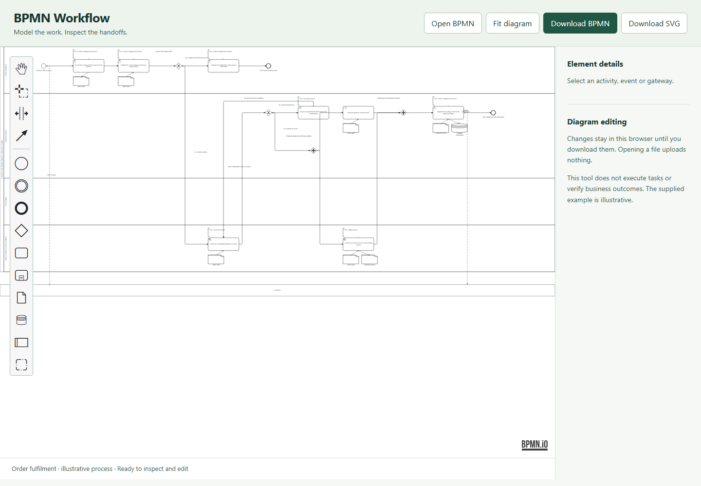

# BPMN Workflow Skill

An independent, domain-neutral agent skill for generating readable BPMN and using
**bpmn.io** to inspect, edit and export it. Includes a local browser editor, a
standard-library Python generator and a complete order-fulfilment example with lanes,
decisions, replenishment, parallel packing/invoicing, systems, documents and messages.

It requires no Legal Engineering repositories, legal methods, model API or account.
It produces and edits diagrams; it does not execute business tasks.

## Use

Copy `skills/bpmn-workflow` into your project's `.agents/skills/` directory, or use it
directly from this checkout. Ask your agent:

> Use bpmn-workflow to model our order process. Show roles, systems, documents, rejection,
> stock replenishment and parallel packing/invoicing. Generate BPMN, inspect it in
> bpmn.io and provide editable XML plus SVG.

Requires Python 3.11+ for generation; Node 24+ for the editor and interchange checker.
From the skill folder:

```sh
cd skills/bpmn-workflow
python scripts/bpmn.py generate examples/order-fulfilment.json --out output/order
npm ci
npm start
```

Open `http://127.0.0.1:8790`. An illustrative example loads immediately. Choose
**Open BPMN**, inspect or edit the model, then **Download BPMN** or **Download SVG**.
Opened files remain in browser memory and are never uploaded. The local server binds
to loopback, checks the Host header and only serves an explicit resource list.



The [skill instructions](skills/bpmn-workflow/SKILL.md) explain the input format,
review process and boundaries. The JSON generator supports a documented subset;
the modeler can edit broader BPMN constructs without converting them into that subset.
Generated JSON and subsequently edited XML are separate artifacts.

## Verify

```sh
cd skills/bpmn-workflow
npm ci
npx playwright install chromium
npm test
node scripts/inspect.mjs examples/order-fulfilment.bpmn
```

Tests generate and parse a real multi-lane process, reject invalid references and
performer assignments, and edit/download actual XML and SVG through bpmn.io. See
[verification](docs/verification.md) and [origin/licence notices](NOTICE.md).
Original source is MIT; bpmn-js retains its bpmn.io licence and visible attribution.
